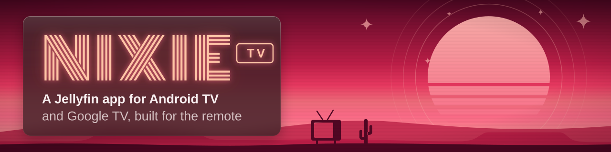
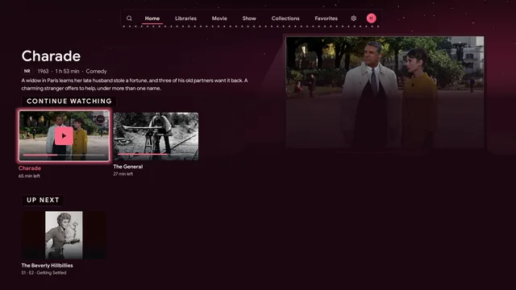
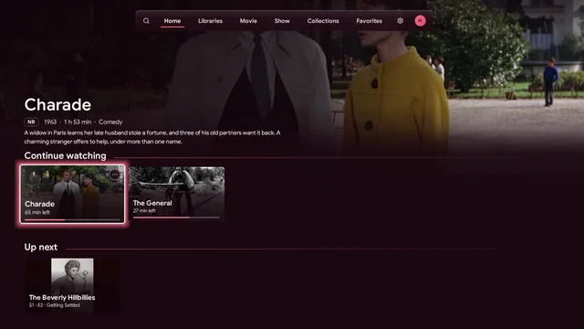
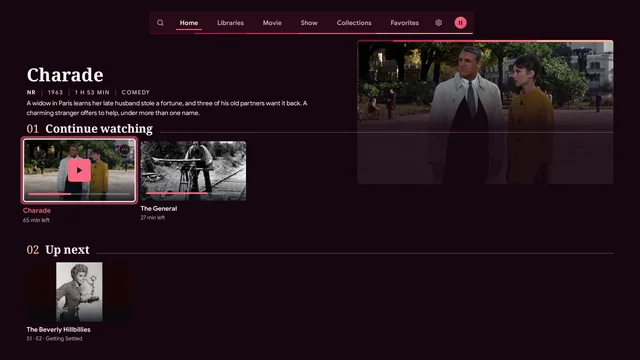
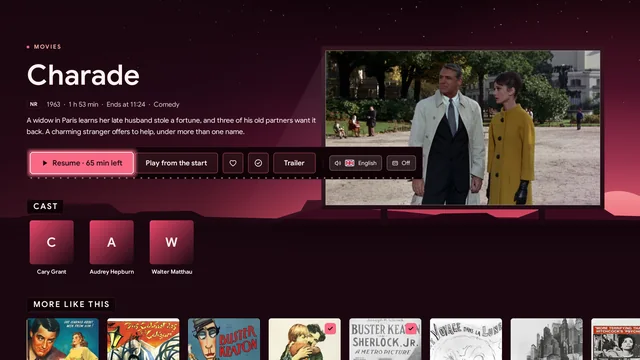
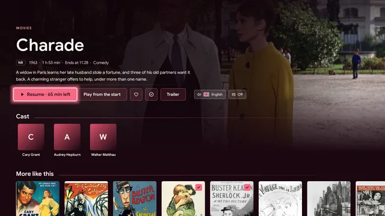
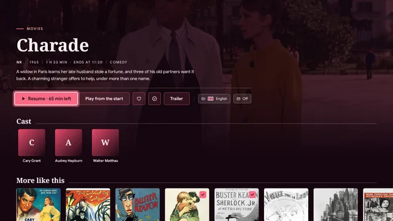
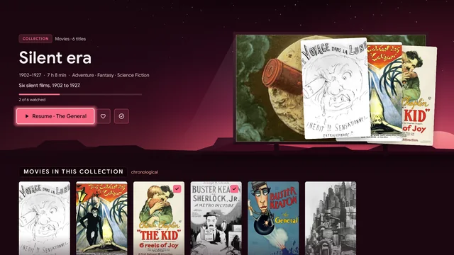
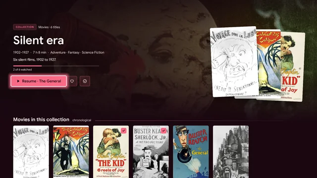
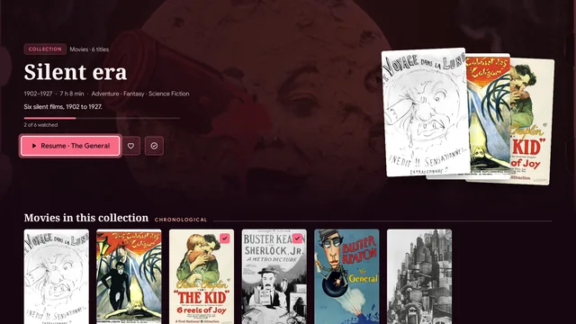

<picture>
  <source media="(prefers-color-scheme: dark)" srcset="docs/brand/banner-dark.svg">
  <source media="(prefers-color-scheme: light)" srcset="docs/brand/banner-light.svg">
  
</picture>

<p>
  <a href="https://github.com/mbustos27/nixie-tv/releases/latest"></a>
  <a href="https://github.com/mbustos27/nixie-tv/blob/main/LICENSE"></a>
  <a href="#install"></a>
  <a href="https://github.com/Glacier-Jellyfin/glacier-androidtv"></a>
</p>

**Nixie for TV is a Jellyfin app for Android TV and Google TV: Nixie's themes on the big screen, with a player built
for the remote.** It is the TV sibling of [Nixie for Windows](https://github.com/mbustos27/nixie).

**Nixie for TV is based on [Glacier](https://github.com/Glacier-Jellyfin/glacier-androidtv) by its authors, under the
GPL-3.0.** Glacier brings the app itself: sign-in, libraries, item pages, search, the Media3 player with its track
rules, skips, trickplay and next-episode countdown, profiles, music, photos and live TV. Nixie adds its themes as a
layer over Glacier's screens, and its own features on top. Glacier's own README, store listings and website belong to
Glacier; see its repository. Please don't report problems in Nixie for TV to Glacier's authors: they can't fix Nixie.

## How it differs from Glacier

Nixie for TV is Glacier v0.10.1 underneath. Most of what the app can do is Glacier's work; Nixie changes how it looks,
a set of everyday behaviours, and where it updates from. The full, file-by-file list is in
[DIVERGENCE.md](DIVERGENCE.md).

**Glacier's, unchanged:** the Media3 player and its device profiles, track rules, styled ASS subtitles, DTS and TrueHD
decoding, trickplay, frame-rate matching and the next-episode countdown; libraries with sort and filter; item pages;
search; profiles with PINs and age limits; music, photos, live TV with a guide, and Seerr requests.

**Changed or added by Nixie:**

| Area | Glacier v0.10.1 | Nixie for TV |
|---|---|---|
| Look | Glacier's own design | Three themes, switched at once: Drive-in (default), Cinematic and Editorial. Glacier's look only in debug builds |
| Name and artwork | Glacier | Nixie's name, icon and banner in every string (English, German, Spanish); About says "Based on Glacier" |
| Home | One merged Continue watching row | Continue watching, then Up next, as two rows |
| Continue watching | No way to remove a title | Hold OK to remove a title, with Undo for 10 seconds |
| Skips | The server's media segments | The server's segments, the file's chapter names, and skips learned from what you skip by hand; online lookups off until you turn them on |
| Sign-in | Password or Quick Connect | Quick Connect first when the server offers it; password as the fallback |
| Big libraries | The first page waits for the list to be counted; an A–Z jump needs the library's index in memory | The first page comes uncounted and shows at once; an A–Z jump asks the server where the letter starts |
| Text size | Fixed at the default font scale | Follows the TV's font size, up to 1.3× |
| Low-memory boxes | Live blur and drop shadows | No live blur or offscreen shadows on 2 GB boxes |
| Trailers | YouTube embed under Glacier's site | youtube-nocookie under Nixie's own origin |
| Updates | Glacier's releases and app stores | This repository's releases only; takes only `Nixie-TV-<version>.apk` and checks its SHA-256 |
| Server's device list | "Glacier" | "Nixie for TV" |
| Publishing | Store, website and funding workflows | Removed; nothing publishes to or pings Glacier |

Nixie's changes live in its own modules (`theme/*`, `io.github.mbustos27` packages) and in small hooks marked
`// Nixie:` inside Glacier's files, so each Glacier release can still be merged ([Glacier's updates](#glaciers-updates)).

**How it differs from Nixie for Windows:** it's a separate app. Nixie for Windows is a WinUI 3 client playing through
mpv with four themes; Nixie for TV is Kotlin and Compose for TV on Glacier, plays through Media3, and has three of
the four themes (no Classic).

## Install

| You need | |
|---|---|
| A TV box or TV | Android TV or Google TV, Android 9 or newer, an ARM processor (32- or 64-bit); or a Fire TV on Fire OS 7 or 8 ([On Fire TV](#on-fire-tv)) |
| A server | A Jellyfin server, version 12.0 or newer, and an account on it |

**Server versions:** Nixie for TV supports Jellyfin 12.0 and newer, the same as Glacier and the Jellyfin SDK it is
built on; its tests and release checks run against Jellyfin 12.4. An older server shows as "not supported" in the
server list, and **Connect anyway** still tries it, but some features may not work there and nothing is tested on one.

Nixie for TV comes from this repository's [releases](https://github.com/mbustos27/nixie-tv/releases) only; it is not
in an app store. Each release has three files:

- **`Nixie-TV-<version>.apk`**, the app.
- **`Nixie-TV-<version>.apk.sha256`**, its checksum ([SECURITY.md](SECURITY.md) shows how to compare them).
- **`nixie-tv.apk`**, the same app under a name that never changes, so
  `https://github.com/mbustos27/nixie-tv/releases/latest/download/nixie-tv.apk` is always the newest release.

**On the TV:** type `is.gd/nixietv` into Downloader or a similar downloader app, or enter the code `6673217` in
Downloader. Either way you get the newest release (Android asks once to let that app install apps). Or install the APK
with a file-manager app on the box, or from a computer with `adb install Nixie-TV-<version>.apk`. It installs beside
Glacier and doesn't share its settings. On a Fire TV, follow [On Fire TV](#on-fire-tv) below.

### On Fire TV

**Not yet tried on a Fire TV.** Fire OS 7 and 8 are built on Android 9 and 11, which Nixie for TV supports, so the same
APK as on Google TV should run; its checks on Fire TV emulators haven't run yet
([docs/FIRE-TV-PLAN.md](docs/FIRE-TV-PLAN.md)). If you try it, a [report](#report-a-problem) of what works and what
doesn't helps.

**Which Fire TVs:** check Settings › My Fire TV › About › Fire TV Stick (or your device's name) › Software Version.

| Your Fire TV runs | Devices | Nixie for TV |
|---|---|---|
| Fire OS 7 | Fire TV Stick 3rd gen, Stick Lite, Stick HD (2024), Stick 4K Max 1st gen, Cube 2nd and 3rd gen | Should run |
| Fire OS 8 | Fire TV Stick 4K 2nd gen (sold as 4K Plus), Stick 4K Max 2nd gen | Should run |
| Fire OS 14 or 16 | Mostly Fire TV televisions | Not checked yet |
| Vega OS | Fire TV Stick 4K Select (2025), Stick HD (2026), Stick 4K 3rd gen (2026) | **Can't run it**: Vega runs no Android apps and allows no sideloading |

**Install it:**

1. **Get Downloader.** On the Fire TV's home, search for **Downloader** (by AFTVnews) and install it from Amazon's
   Appstore.
2. **Turn on Developer options.** Settings › My Fire TV › About, then select your device's name (for example
   "Fire TV Stick 4K") **seven times**, until it says you're a developer. Press Back.
3. **Let Downloader install apps.** Settings › My Fire TV › Developer options › **Install unknown apps** ›
   **Downloader** › On. (On older Fire OS this is **Apps from Unknown Sources** › On.) If Downloader isn't in the
   list, update the Fire TV first (Settings › My Fire TV › About › Check for Updates): a Fire OS bug hid it there until
   a fix in September 2026.
4. **Download Nixie.** Open Downloader, enter the code **`6673217`** (or `is.gd/nixietv`), select Go, then **Install**
   when Android asks. Downloader can delete the APK file afterwards; the app stays.
5. **Open Nixie for TV** from Your Apps & Channels (hold Home › Apps). To pin it to the home row, highlight it, press
   the menu (☰) button and choose Move to front.

**Updates** work as on Google TV: the first time Nixie offers an update, Android asks to let **Nixie for TV** install
apps (Developer options › Install unknown apps › Nixie for TV › On).

**Not checked on a Fire TV yet:**

- Dolby audio passthrough to a receiver. DTS and TrueHD are decoded in the app, as on Google TV.
- HDR and Dolby Vision output, and switching the refresh rate to match the video.
- Speed on 1 GB sticks.
- The Continue watching row on the TV's home screen: Fire TV's home doesn't show other apps' rows, so it stays in
  the app.

**Updates:** Nixie checks for a new release at every start (Settings › System › Check for updates automatically turns
that off; Check for updates checks at once). It asks GitHub's releases API for this repository's releases and nothing
else, and sends nothing about you beyond what any web request carries: no server, account, library or device facts. A
new release shows its notes and waits for you; nothing downloads or installs until you choose Update now. Nixie takes
only `Nixie-TV-<version>.apk`, and checks its SHA-256 against the digest GitHub publishes, its package name and its
version before installing. Android then refuses any update that isn't signed with the same key as the installed app.

## The themes

Settings › Appearance › Theme switches at once, and your place is kept.

- **Drive-in**, the default: a desert-sunset palette, warm glass on the bar and buttons, a two-tone neon focus ring,
  and nixie tubes for numbers.
- **Cinematic**: a night-dark page, glass on the bar, and a white-rimmed focus frame in a wide glow, easy to follow from
  the couch.
- **Editorial**: an ink page with serif headings, flat tints instead of glass, and a focus frame like a printer's
  double rule.

Debug builds also offer Glacier's own look, for comparing.

<table>
  <tr>
    <th width="33%">Drive-in</th>
    <th width="33%">Cinematic</th>
    <th width="33%">Editorial</th>
  </tr>
  <tr>
    <td>
      <a href="docs/screenshots/home-drive-in.webp">
        
      </a><br>Home
    </td>
    <td>
      <a href="docs/screenshots/home-cinematic.webp">
        
      </a><br>Home
    </td>
    <td>
      <a href="docs/screenshots/home-editorial.webp">
        
      </a><br>Home
    </td>
  </tr>
  <tr>
    <td>
      <a href="docs/screenshots/movie-drive-in.webp">
        
      </a><br>A film
    </td>
    <td>
      <a href="docs/screenshots/movie-cinematic.webp">
        
      </a><br>A film
    </td>
    <td>
      <a href="docs/screenshots/movie-editorial.webp">
        
      </a><br>A film
    </td>
  </tr>
  <tr>
    <td>
      <a href="docs/screenshots/collection-drive-in.webp">
        
      </a><br>A collection
    </td>
    <td>
      <a href="docs/screenshots/collection-cinematic.webp">
        
      </a><br>A collection
    </td>
    <td>
      <a href="docs/screenshots/collection-editorial.webp">
        
      </a><br>A collection
    </td>
  </tr>
</table>

Taken on the Android TV emulator, against the TV test server ([testing/fakeserver](testing/fakeserver)) serving
the public-domain films of Nixie for Windows' [showcase library](https://github.com/mbustos27/nixie/tree/main/tools/ui-harness/fakeserver/showcase)
(credits under [Licence](#licence)).

## What it does

- **Home** shows Continue watching, then Up next.
- **Big libraries open fast:** the first page shows while the rest loads, and the A–Z rail jumps without reading the
  whole library first.
- **Search** shows each kind of result as it arrives.
- **Playback** on the box's own decoders: 4K, HDR10 and Dolby Vision where the TV shows them, DTS and TrueHD decoded
  in the app when the box can't, styled ASS subtitles, trickplay, frame-rate matching and the next-episode countdown.
  The player lets go in standby and comes back paused where you were.
- **Skips:** intros and credits from the server, from the file's chapters, and learned from what you skip by hand.
  Looking them up online stays off until you turn it on.
- **Continue watching:** hold OK on a title to remove it, with Undo for 10 seconds. The same row can show on the TV's
  home screen, where the home screen supports it.
- **Trailers** from the server, or from YouTube.
- **Profiles** with PINs and age limits, Quick Connect, music, photos, live TV with a guide, and requests where the
  server offers Seerr.
- **English, German and Spanish**, following the TV's language.

## Report a problem

1. On the TV, open **Settings › System › Diagnostics**. For a playback problem, turn on **Detailed logging** first and
   make the problem happen again.
2. Choose **Report a problem** and scan the code with a phone. It opens the **Report a problem** form here, with the
   app's and the server's versions filled in. The TV sends nothing.
3. For the log, choose **Download log on the network** and scan that code with a phone on the same network. The phone
   saves the log as a text file (server addresses and names, signed-in users' names, passwords and access tokens are
   taken out first; [PRIVACY.md](PRIVACY.md#logs-and-report-a-problem) says what stays). Drag it into the form.

Without a phone, [open an issue](https://github.com/mbustos27/nixie-tv/issues/new/choose) with the **Report a problem**
form. **Send log to the server**, in the same place, sends the log to the server admin's dashboard, not here.

## Privacy, in short

No account, analytics, ads or telemetry. What leaves the box:

- **The Jellyfin server you use** gets what any Jellyfin app sends: sign-in, what you play and how far, watched marks
  and favourites, and a copy of your Nixie settings.
- **The TV's home screen** gets your Continue watching titles, as Android TV apps do (Settings › Home turns it off).
- **YouTube:** on a page with a YouTube trailer, Nixie loads YouTube's player empty; YouTube gets the video's id only
  when you press Trailer.
- **GitHub** is asked for new releases at every start (you can turn it off), with nothing about you.
- **Online skip lookups** send a show's public id, the episode's number and its length, only once you turn them on.
- **Logs** leave the box only when you fetch or send one.

All of it, with what each service gets: [PRIVACY.md](PRIVACY.md).

## Build

Needs the Android SDK (platform 37) and JDK 21 (Android Studio's own works), set for the shell only:

```powershell
$env:JAVA_HOME = 'C:\Program Files\Android\Android Studio\jbr'
$env:ANDROID_HOME = "$env:LOCALAPPDATA\Android\Sdk"
.\gradlew.bat :app:assembleNixieDebug testDebugUnitTest :app:testNixieDebugUnitTest
# app\build\outputs\apk\nixie\debug\app-nixie-debug.apk
```

- One flavor, `nixie`: application id `io.github.mbustos27.nixie.tv`, debug builds `.debug` beside it.
- The version is `nixie.version` in `gradle.properties`, versionCode by Glacier's rule
  (major × 1,000,000 + minor × 10,000 + patch × 100 + beta, 99 for a stable release).
- The FFmpeg audio decoder (DTS, TrueHD) needs its native part built first: [core/ffmpeg/README.md](core/ffmpeg/README.md).
- Debug builds switch themes with `adb shell am start -n io.github.mbustos27.nixie.tv.debug/io.github.glacier_jellyfin.androidtv.MainActivity --es nixie.theme Cinematic`.

## Development

- [CONTRIBUTING.md](CONTRIBUTING.md): how to report, suggest and send changes.
- [docs/DESIGN-RULES.md](docs/DESIGN-RULES.md): what every change and bug hunt looks for (speed on big servers,
  standby, device facts, the way up from any page, the user is not the server's admin).
- [docs/GLACIER-BASE.md](docs/GLACIER-BASE.md): what Glacier covers and what Nixie adds.
- [DIVERGENCE.md](DIVERGENCE.md): every change to a Glacier file.
- [docs/THEMES.md](docs/THEMES.md): how the themes plug into Glacier's screens.
- [docs/ARCHITECTURE.md](docs/ARCHITECTURE.md): Glacier's module layout, which Nixie keeps.
- [testing/README.md](testing/README.md): the fake Jellyfin server's profiles. Tests never touch a real server.
- `tools/release-check`: `nixie-release`, the release checks (signature, manifest, versionCode, ABIs, the FFmpeg
  decoder, alignment, size, `.sha256`). It never signs and never reads a key.

## Glacier's updates

`upstream` is Glacier, fetch only. Each Glacier release that builds is merged with `git merge`; Nixie's changes stay
in its own modules and in hooks marked `// Nixie:` (the rule: [docs/GLACIER-BASE.md](docs/GLACIER-BASE.md#merging-glaciers-updates)).

## Licence

GPL-3.0-or-later ([LICENSE](LICENSE)), as Glacier. Every copyright and REUSE notice is kept: Glacier's files are
"Glacier contributors", Nixie's own files "Nixie contributors" ([REUSE.toml](REUSE.toml)); third-party parts keep
their licences, with the texts in [LICENSES/](LICENSES/). Nixie for TV is not affiliated with the Jellyfin project or
with Glacier's authors. Android TV and Google TV are trademarks of Google LLC.

The screenshots show public-domain films, Charade (1963), The General (1926), His Girl Friday (1940), The Cabinet of
Dr. Caligari (1920), The Kid (1921), Sherlock Jr. (1924), A Trip to the Moon (1902), Metropolis (1927) and Night of
the Living Dead (1968), and The Beverly Hillbillies (1962) through a public-domain press photo. The stills and posters
come from Wikimedia Commons, and the overviews are our own. Public domain covers the pictures; the titles' logos and
trademarks on the posters are not covered by it. The app scales, cuts and tints the pictures on screen.

<details>
<summary>All 12 pictures, with their authors, licences and sources</summary>

- **The Beverly Hillbillies (1962)**, press photo: CBS Television. Public domain (PD-US-no notice). Changes: reduced
  to 1080 px high, in the middle of a dark 1920 x 1080 frame.
  [Wikimedia Commons](https://commons.wikimedia.org/wiki/File:Donna_Douglas_in_%22Beverly_Hillbillies%22_%281963_Press_photo%29.jpg)
- **The Cabinet of Dr. Caligari (1920)**, poster: Atelier Ledl Bernhard. Public domain (PD-old-80-expired). Changes:
  reduced to 600 px wide.
  [Wikimedia Commons](https://commons.wikimedia.org/wiki/File:Das_Cabinet_des_Dr._Caligari.JPG)
- **Charade (1963)**, still: Stanley Donen. Public domain (PD-US-not renewed). Changes: cut to 16:9, enlarged to 1920
  x 1080.
  [Wikimedia Commons](https://commons.wikimedia.org/wiki/File:Charade_1963_Audrey_Hepburn_and_Cary_Grant.jpg)
- **The General (1926)**, still: Buster Keaton Productions. Public domain (PD-1923). Changes: cut to 16:9, reduced to
  1920 x 1080.
  [Wikimedia Commons](https://commons.wikimedia.org/wiki/File:Buster_Keaton_drives_a_two-man,_railroad_handcar_in_The_General.jpg)
- **The General (1926)**, poster: United Artists. Public domain (PD-1923). Changes: reduced to 600 px wide.
  [Wikimedia Commons](https://commons.wikimedia.org/wiki/File:The_General_%281926%29_-_Movie_Poster_2.png)
- **His Girl Friday (1940)**, poster: Columbia Pictures. Public domain (PD-US-not renewed). Changes: reduced to 600 px
  wide.
  [Wikimedia Commons](https://commons.wikimedia.org/wiki/File:His_Girl_Friday_%281940_poster%29_crop.jpg)
- **The Kid (1921)**, poster: First National. Public domain (PD-1923, PD-scan). Changes: reduced to 600 px wide.
  [Wikimedia Commons](https://commons.wikimedia.org/wiki/File:The_Kid_%281921%29_poster.jpg)
- **Metropolis (1927)**, poster: Boris Bilinsky. Public domain (PD-Art / PD-old-70). Changes: reduced to 600 px wide.
  [Wikimedia Commons](https://commons.wikimedia.org/wiki/File:Boris_Bilinski_-_Filmplakat_f%C3%BCr_Metropolis_restored.jpg)
- **Night of the Living Dead (1968)**, poster: author unknown. Public domain (PD-US-no notice). Changes: reduced to
  600 px wide.
  [Wikimedia Commons](https://commons.wikimedia.org/wiki/File:Night_Of_The_Living_Dead_%281968%29_-_Poster.jpg)
- **Sherlock Jr. (1924)**, poster: author unknown. Public domain (PD-1923). Changes: reduced to 600 px wide.
  [Wikimedia Commons](https://commons.wikimedia.org/wiki/File:Sherlock_jr_poster.jpg)
- **A Trip to the Moon (1902)**, still: Georges Méliès. Public domain (PD-old-80-expired). Changes: cut to 16:9,
  reduced to 1920 x 1080.
  [Wikimedia Commons](https://commons.wikimedia.org/wiki/File:Melies_color_Voyage_dans_la_lune.jpg)
- **A Trip to the Moon (1902)**, poster: Georges Méliès (sketch for the poster). Public domain (PD-old-70-expired).
  Changes: reduced to 600 px wide.
  [Wikimedia Commons](https://commons.wikimedia.org/wiki/File:Voyage_dans_la_Lune_affiche.jpg)

</details>
